# 3-Tier To-Do Application on AWS EC2

A 3-tier (Web, Application, Database) To-Do application deployed on a custom AWS VPC.
Nginx is the **only public entry point**. The API and database run in private subnets.


## 1. Architecture

```
                Internet
                   │
          ┌────────▼─────────┐  Internet Gateway
          │ PUBLIC 10.0.1.0/24│
          │  web-server       │  Nginx: HTTPS, serves HTML,
          │  (only public IP) │  load-balances /api/
          └───┬──────────┬────┘
              │ :3000    │ :3000
   ┌──────────▼──┐  ┌────▼────────┐   PRIVATE-APP 10.0.2.0/24
   │ app-server-1│  │ app-server-2│   Node.js API (systemd)
   └──────────┬──┘  └────┬────────┘
              │ :3306    │ :3306
          ┌───▼──────────▼───┐        PRIVATE-DB 10.0.3.0/24
          │    db-server     │        MySQL
          └──────────────────┘
Private subnets reach the internet only via the NAT Gateway (for package installs).
```

**Traffic flow:** Browser → `https://<web-public-ip>` → Nginx (web-server) → API on app-server-1/2 (port 3000) → MySQL on db-server (port 3306).

## 2. Technology Stack

| Tier | Server | Software |
|------|--------|----------|
| Web | web-server (public subnet) | Ubuntu 22.04, Nginx, HTML/JavaScript frontend |
| Application | app-server-1, app-server-2 (private subnet) | Ubuntu 22.04, Node.js 20, Express, mysql2, systemd |
| Database | db-server (private subnet) | Ubuntu 22.04, MySQL 8 |

Not used (per assignment rules): ALB/NLB, RDS, Elastic Beanstalk, ECS, EKS, SSM Session Manager.

---

## 3. Network Design

| Resource | Name | CIDR / Details |
|----------|------|----------------|
| VPC | todo-vpc | 10.0.0.0/16 |
| Public subnet | public-subnet | 10.0.1.0/24 |
| Private subnet (app) | private-app-subnet | 10.0.2.0/24 |
| Private subnet (db) | private-db-subnet | 10.0.3.0/24 |
| Internet Gateway | todo-igw | Attached to todo-vpc |
| NAT Gateway | todo-nat | In public-subnet, with Elastic IP |

### Screenshots for VPC Here
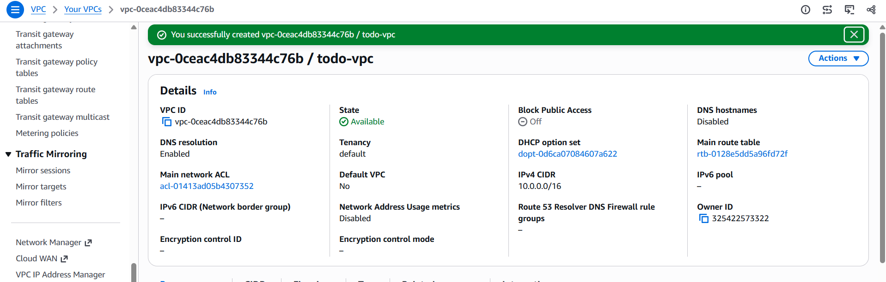

### Screenshots for Subnets Here
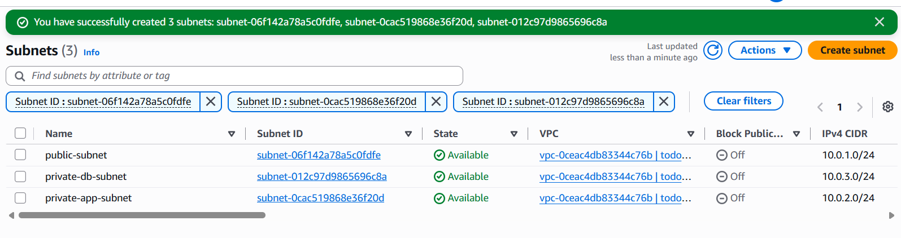

### Screenshots for Internet Gateway Here
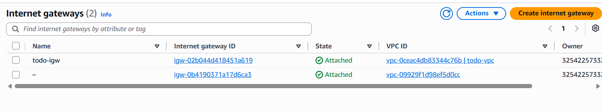

### Screenshots for NAT Gateway Here
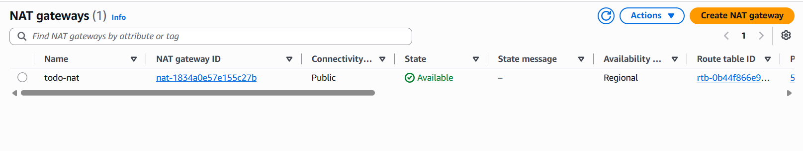

### Route Tables

| Route Table | Destination | Target | Associated Subnets |
|-------------|-------------|--------|--------------------|
| public-rt | 10.0.0.0/16 | local | public-subnet |
| public-rt | 0.0.0.0/0 | Internet Gateway | public-subnet |
| private-rt | 10.0.0.0/16 | local | private-app-subnet, private-db-subnet |
| private-rt | 0.0.0.0/0 | NAT Gateway | private-app-subnet, private-db-subnet |

### Screenshots for Public Route Table Here
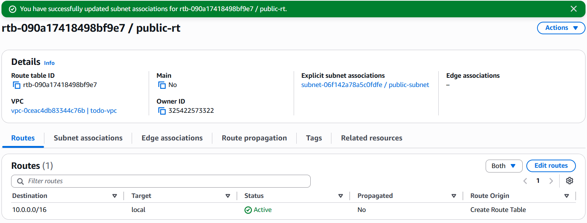

### Screenshots for Private Route Table Here
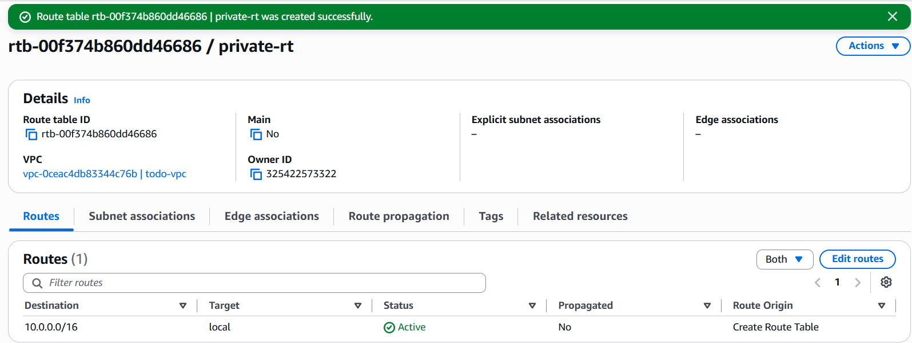

---

## 4. Security Groups

Each tier accepts traffic **only from the tier directly before it**.

| Security Group | Protocol / Port | Source |
|----------------|-----------------|--------|
| **web-sg** | HTTP 80 | 0.0.0.0/0 |
| | HTTPS 443 | 0.0.0.0/0 |
| | SSH 22 | My IP only |
| **app-sg** | TCP 3000 | web-sg |
| | SSH 22 | web-sg |
| **db-sg** | TCP 3306 | app-sg |
| | SSH 22 | web-sg |

### Screenshots for web-sg Here
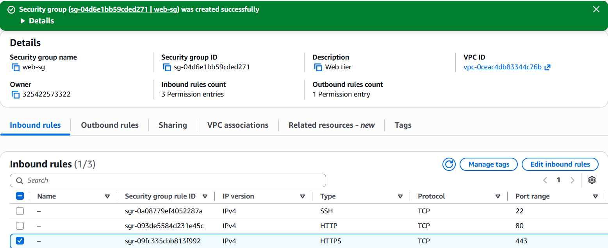

### Screenshots for app-sg Here
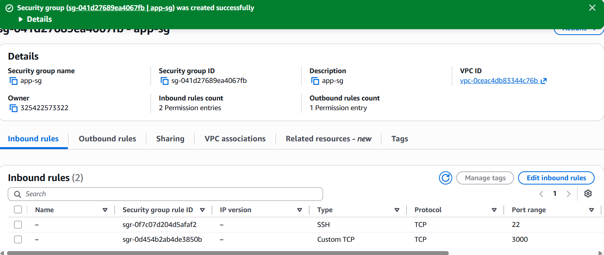

### Screenshots for db-sg Here
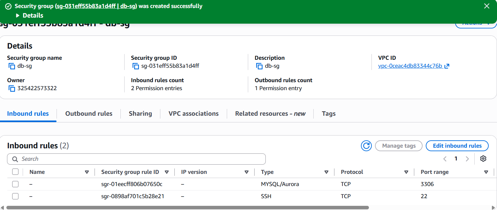

---

## 5. EC2 Instances

| Name | Subnet | Public IP | Private IP | Security Group |
|------|--------|-----------|------------|----------------|
| web-server | public-subnet | Yes | 10.0.1.48 | web-sg |
| app-server-1 | private-app-subnet | **No** | 10.0.2.44 | app-sg |
| app-server-2 | private-app-subnet | **No** | 10.0.2.64 | app-sg |
| db-server | private-db-subnet | **No** | 10.0.3.84 | db-sg |

### Screenshots for EC2 Instances Here
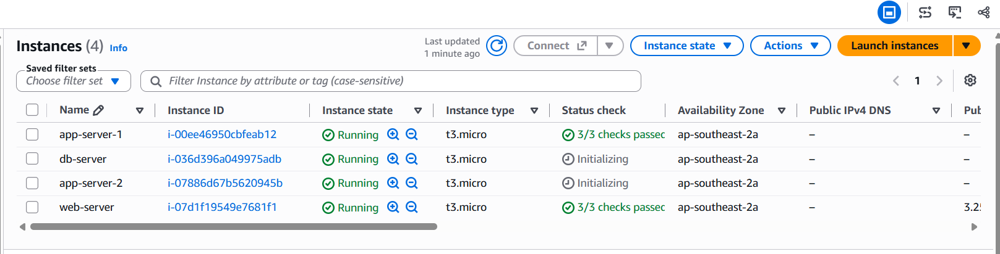

---

## 6. Accessing Private Servers

Web server is used as a **jump host (bastion)**.
The `.pem` key stays on the local machine and is never copied to AWS.

SSH config on the local machine (`~/.ssh/config`, Git Bash on Windows):

```
Host web
    HostName <WEB_PUBLIC_IP>
    User ubuntu
    IdentityFile ~/.ssh/todo-key.pem

Host app1
    HostName 10.0.2.x
    User ubuntu
    IdentityFile ~/.ssh/todo-key.pem
    ProxyJump web

Host app2
    HostName 10.0.2.y
    User ubuntu
    IdentityFile ~/.ssh/todo-key.pem
    ProxyJump web

Host db
    HostName 10.0.3.x
    User ubuntu
    IdentityFile ~/.ssh/todo-key.pem
    ProxyJump web
```

Usage: `ssh web`, `ssh app1`, `ssh app2`, `ssh db`.

### Screenshots for SSH Jump Host Login Here
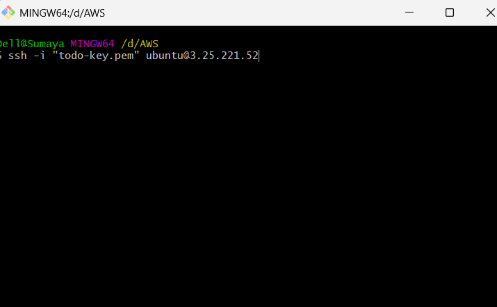

---

## 7. Database Tier – db-server

**Runs:** MySQL 8 (listens only on the private IP; accepts connections only from the app subnet).  
**Files:** `db/schema.sql`, `scripts/setup-db.sh`

### Installation

```bash
sudo apt update && sudo apt install -y mysql-server
sudo nano /etc/mysql/mysql.conf.d/mysqld.cnf
#   bind-address = 10.0.3.x        <- db-server private IP
sudo systemctl restart mysql
sudo systemctl enable mysql
```

### db/schema.sql

```sql
CREATE DATABASE IF NOT EXISTS tododb;
CREATE USER IF NOT EXISTS 'todo'@'10.0.2.%' IDENTIFIED BY 'StrongPass#123';
GRANT ALL PRIVILEGES ON tododb.* TO 'todo'@'10.0.2.%';
USE tododb;
CREATE TABLE IF NOT EXISTS tasks (
  id INT AUTO_INCREMENT PRIMARY KEY,
  title VARCHAR(255) NOT NULL,
  done TINYINT(1) DEFAULT 0,
  created_at TIMESTAMP DEFAULT CURRENT_TIMESTAMP
);
INSERT INTO tasks (title) VALUES ('Learn VPC'), ('Deploy 3-tier app');
FLUSH PRIVILEGES;
```

Apply with: `sudo mysql < db/schema.sql`

### Verify

```bash
sudo ss -tlnp | grep 3306
sudo mysql -e "SELECT * FROM tododb.tasks;"
```

### Screenshots for MySQL Installation and Tasks Table Here
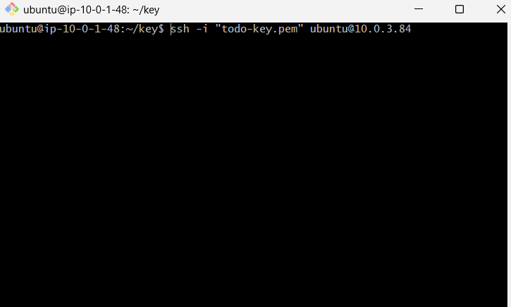

---

## 8. Application Tier – app-server-1 / app-server-2

**Runs:** Node.js (Express) REST API on port 3000, managed by **systemd** so it starts on boot and restarts on failure.  
**Files:** `app/server.js`, `app/package.json`, `app/todo-api.service`, `scripts/setup-app.sh`

### Installation

```bash
curl -fsSL https://deb.nodesource.com/setup_20.x | sudo -E bash -
sudo apt install -y nodejs git
sudo mkdir -p /opt/todo-api && sudo chown ubuntu: /opt/todo-api
cd /opt/todo-api && npm init -y && npm i express mysql2
```

### app/server.js

```js
const express = require('express');
const mysql = require('mysql2/promise');
const os = require('os');

const pool = mysql.createPool({
  host: process.env.DB_HOST, user: process.env.DB_USER,
  password: process.env.DB_PASS, database: process.env.DB_NAME,
  connectionLimit: 5
});
const app = express();
app.use(express.json());

app.get('/api/health', (req, res) => res.json({ ok: true, server: os.hostname() }));
app.get('/api/tasks', async (req, res) => {
  const [rows] = await pool.query('SELECT * FROM tasks ORDER BY id DESC');
  res.json({ server: os.hostname(), tasks: rows });
});
app.post('/api/tasks', async (req, res) => {
  const [r] = await pool.query('INSERT INTO tasks (title) VALUES (?)', [req.body.title]);
  res.status(201).json({ id: r.insertId });
});
app.put('/api/tasks/:id', async (req, res) => {
  await pool.query('UPDATE tasks SET done = NOT done WHERE id = ?', [req.params.id]);
  res.json({ ok: true });
});
app.delete('/api/tasks/:id', async (req, res) => {
  await pool.query('DELETE FROM tasks WHERE id = ?', [req.params.id]);
  res.json({ ok: true });
});
app.listen(3000, '0.0.0.0');
```

### Environment file – `/etc/todo-api.env` (`chmod 600`)

```
DB_HOST=10.0.3.x
DB_USER=todo
DB_PASS=StrongPass#123
DB_NAME=tododb
```

### systemd service – `/etc/systemd/system/todo-api.service`

```ini
[Unit]
Description=Todo API
After=network.target

[Service]
User=ubuntu
WorkingDirectory=/opt/todo-api
EnvironmentFile=/etc/todo-api.env
ExecStart=/usr/bin/node server.js
Restart=always

[Install]
WantedBy=multi-user.target
```

```bash
sudo systemctl daemon-reload
sudo systemctl enable --now todo-api
curl localhost:3000/api/tasks
```

### Reboot test (service must come back automatically)

```bash
sudo reboot
# after ~1 minute, SSH back in:
systemctl status todo-api
```

### Screenshots for App Server 1 API Running Here
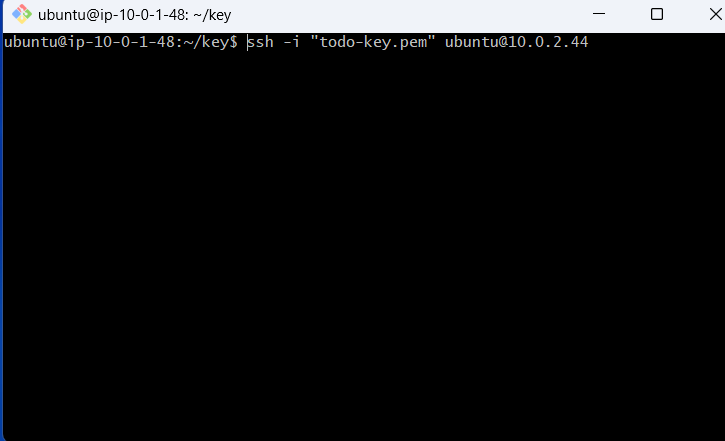

### Screenshots for App Server 2 API Running Here
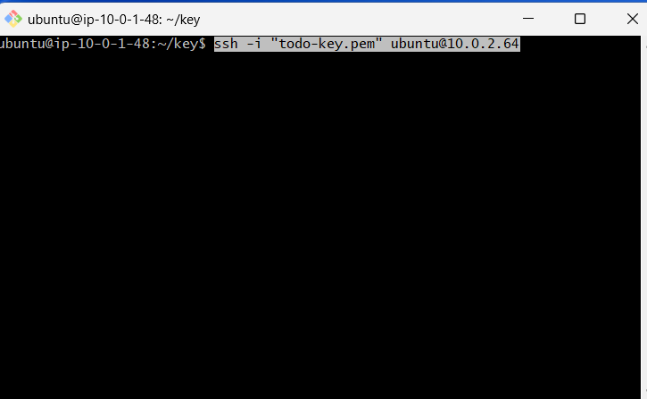


---

## 9. Web Tier – web-server

**Runs:** Nginx. It serves the static frontend and reverse-proxies `/api/` requests to the application tier.  
**Files:** `web/index.html`, `web/nginx-todo.conf`, `scripts/setup-web.sh`

### Installation

```bash
sudo apt update && sudo apt install -y nginx openssl
sudo mkdir -p /var/www/todo
sudo cp web/index.html /var/www/todo/index.html
```

### web/index.html

```html
<!DOCTYPE html>
<html><head><meta charset="utf-8"><title>3-Tier To-Do</title>
<style>body{font-family:sans-serif;max-width:500px;margin:40px auto}
li{margin:6px 0}.done{text-decoration:line-through;color:#888}</style></head>
<body>
<h2>To-Do List</h2>
<input id="t" placeholder="New task"><button onclick="add()">Add</button>
<ul id="list"></ul><small id="srv"></small>
<script>
async function load(){
  const r = await (await fetch('/api/tasks')).json();
  srv.textContent = 'Served by: ' + r.server;
  list.innerHTML = r.tasks.map(x =>
    `<li class="${x.done?'done':''}"><span onclick="tog(${x.id})">${x.title}</span>
     <button onclick="del(${x.id})">x</button></li>`).join('');
}
async function add(){
  await fetch('/api/tasks',{method:'POST',headers:{'Content-Type':'application/json'},
    body:JSON.stringify({title:t.value})}); t.value=''; load();
}
async function tog(id){ await fetch('/api/tasks/'+id,{method:'PUT'}); load(); }
async function del(id){ await fetch('/api/tasks/'+id,{method:'DELETE'}); load(); }
load();
</script></body></html>
```

### Enable the site

```bash
sudo cp web/nginx-todo.conf /etc/nginx/sites-available/todo
sudo ln -s /etc/nginx/sites-available/todo /etc/nginx/sites-enabled/
sudo rm /etc/nginx/sites-enabled/default
sudo nginx -t && sudo systemctl restart nginx && sudo systemctl enable nginx
```

The full `nginx-todo.conf` is shown in sections 10 and 11 below.

### Screenshots for Nginx Running Here
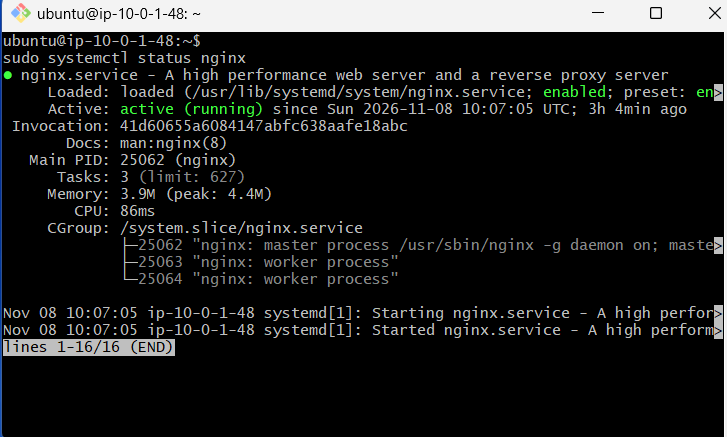

### Screenshots for Working Application in Browser Here
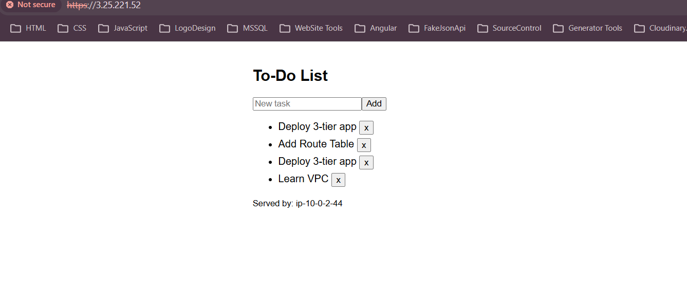

### Screenshots for Data Persisting in Database Here
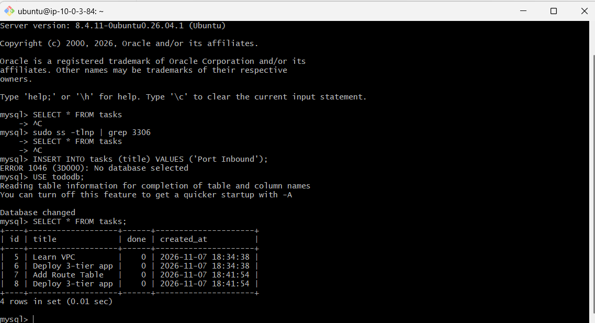

---

## 10. Bonus 1 – Nginx Load Balancing

Nginx distributes `/api/` requests between the two application servers using a round-robin `upstream` block.

```nginx
upstream todo_api {
    server 10.0.2.44:3000;    # app-server-1
    server 10.0.2.64:3000;    # app-server-2
}
```

The frontend displays "Served by: <hostname>", and the `X-Upstream` response header shows which backend answered. Refresh the page several times and the hostname alternates.

Check from the web server:

```bash
for i in 1 2 3 4; do curl -sk https://localhost/api/health; echo; done
```

### Screenshots for Load Balancing (Alternating Servers) Here
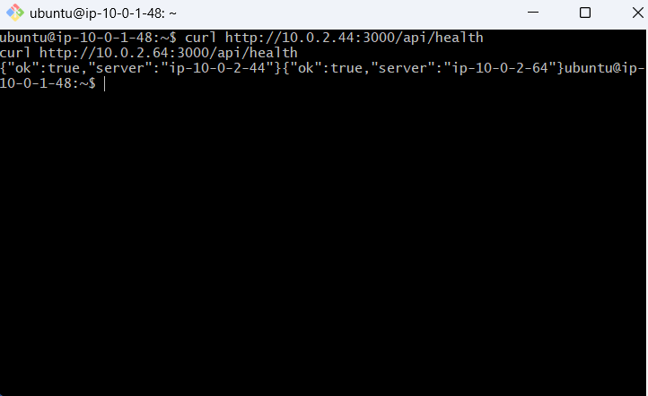

---


### web/nginx-todo.conf (complete)

```nginx
upstream todo_api {
    server 10.0.2.44:3000;
    server 10.0.2.64:3000;
}

server {
    listen 80;
    return 301 https://$host$request_uri;
}

server {
    listen 443 ssl;
    ssl_certificate     /etc/ssl/certs/todo.crt;
    ssl_certificate_key /etc/ssl/private/todo.key;

    root /var/www/todo;
    index index.html;

    location / { try_files $uri /index.html; }

    location /api/ {
        proxy_pass http://todo_api;
        proxy_set_header Host $host;
        proxy_set_header X-Real-IP $remote_addr;
        add_header X-Upstream $upstream_addr always;
    }
}
```


--

## 11. Problems Faced and Solutions

| # | Problem | Cause | Solution |
|---|---------|-------|----------|
| 1 | `apt update` hung on private servers | Private route table had no NAT route | Added `0.0.0.0/0 → NAT Gateway` to `private-rt` |
| 2 | Could not SSH into private servers | No public IP; SSM not allowed | Used the web server as a jump host (`ProxyJump`) |
| 3 | `.ssh/config: No such file or directory` on Windows | `.ssh` folder did not exist | Ran `mkdir -p ~/.ssh` and then created the config |
| 4 | API could not connect to MySQL (`ECONNREFUSED`) | MySQL was bound to 127.0.0.1 | Set `bind-address` to the private IP and restarted MySQL |
| 5 | `Access denied for user 'todo'` | User was created for `localhost` only | Created `'todo'@'10.0.2.%'` |
| 6 | Nginx `502 Bad Gateway` | API stopped, or app-sg blocked port 3000 | Checked `systemctl status todo-api` and allowed 3000 from web-sg |
| 7 | API stopped after reboot | Started manually with `node` | Created a systemd service with `enable` and `Restart=always` |
| 8 | Browser SSL warning | Self-signed certificate | Expected without a domain; proceed manually |

_Replace or extend this table with the actual problems you faced._

---

## 12. Repository Structure

```
3tier-todo-aws/
├── README.md
├── docs/
│   ├── architecture.png
│   └── screenshots/
│       ├── 01-vpc.png
│       ├── 02-subnets.png
│       └── ... (all screenshots listed above)
├── web/
│   ├── index.html
│   └── nginx-todo.conf
├── app/
│   ├── server.js
│   ├── package.json
│   └── todo-api.service
├── db/
│   └── schema.sql
└── scripts/
    ├── setup-web.sh
    ├── setup-app.sh
    └── setup-db.sh
```
## Bastion Host History
Summary:
  Upgrading: 0, Installing: 0, Removing: 0, Not Upgrading: 0
ubuntu@ip-10-0-1-48:~$ sudo nano /etc/nginx/sites-available/todo
ubuntu@ip-10-0-1-48:~$ sudo ln -s /etc/nginx/sites-available/todo /etc/nginx/sites-enabled/
ubuntu@ip-10-0-1-48:~$ sudo rm /etc/nginx/sites-enabled/default
ubuntu@ip-10-0-1-48:~$ sudo nginx -t && sudo systemctl restart nginx && sudo systemctl enable nginx
nginx: the configuration file /etc/nginx/nginx.conf syntax is ok
nginx: configuration file /etc/nginx/nginx.conf test is successful
Synchronizing state of nginx.service with SysV service script with /usr/lib/systemd/systemd-sysv-install.
Executing: /usr/lib/systemd/systemd-sysv-install enable nginx
ubuntu@ip-10-0-1-48:~$ history
    1  sudo apt update
    2  sudo apt upgrade
    3  copy todo-key.pem
    4  ls
    5  baston-server
    6  cd baston-server
    7  ls
    8  cat todo-key.pem
    9  cd .
   10  cd ..
   11  pwd
   12  mdir key
   13  mkdir key
   14  cd key
   15  touch todo-key.pem
   16  nano todo-key
   17  cd.
   18  cd ..
   19  pwd
   20  ~/baston-server$
   21  cd baston-server
   22  cat todo-key.pem
   23  cd..
   24  cd ..
   25  pwd
   26  cd key
   27  ls
   28  nano todo-key.pem
   29  clear
   30  chmod 400 "todo-key.pem"
   31  ssh -i "todo-key.pem" ubuntu@10.0.3.84
   32  exit
   33  clear
   34  cd key
   35  chmod 400 "todo-key.pem"
   36  ssh -i "todo-key.pem" ubuntu@10.0.3.84
   37  clear
   38  cd key
   39  chmod 400 "todo-key.pem"
   40  ssh -i "todo-key.pem" ubuntu@10.0.2.44
   41  clear
   42  ssh -i "todo-key.pem" ubuntu@10.0.2.44
   43  exit
   44  clear
   45  cd key
   46  chmod 400 "todo-key.pem"
   47  ssh -i "todo-key.pem" ubuntu@10.0.2.44
   48  exit
   49  clear
   50  cd key
   51  chmod 400 "todo-key.pem"
   52  ssh -i "todo-key.pem" ubuntu@10.0.3.84
   53  clear
   54  exit
   55  clear
   56  cd key
   57  ssh -i "todo-key.pem" ubuntu@10.0.2.64
   58  cd ..
   59  pwd
   60  sudo apt update && sudo apt install -y nginx openssl
   61  ls-la
   62  clear
   63  ls -la
   64  sudo mkdir -p /var/www/todo
   65  /var/www/todo/index.html
   66  cd  /var/www/todo
   67  cd /var/www/todo
   68  clear
   69  touch index.html
   70  cd ..
   71  pwd
   72  cd /home/ubuntu
   73  pwd
   74  sudo nano /var/www/todo/index/index.html
   75  cat index.html
   76  sudo openssl req -x509 -nodes -days 365 -newkey rsa:2048   -keyout /etc/ssl/private/todo.key -out /etc/ssl/certs/todo.crt   -subj "/CN=todo.local"
   77  pwd
   78  ls -la
   79  clear
   80  sudo apt update && sudo apt install -y nginx
   81  sudo nano /etc/nginx/sites-available/todo
   82  sudo ln -s /etc/nginx/sites-available/todo /etc/nginx/sites-enabled/
   83  sudo rm /etc/nginx/sites-enabled/default
   84  sudo nginx -t && sudo systemctl restart nginx && sudo systemctl enable nginx
   85  history

## Database Host History
   ubuntu@ip-10-0-3-84:~$ sudo nano /etc/mysql/mysql.conf.d/mysqld.cnf
ubuntu@ip-10-0-3-84:~$ sudo systemctl restart mysql
ubuntu@ip-10-0-3-84:~$ sudo systemctl status mysql
● mysql.service - MySQL Community Server
     Loaded: loaded (/usr/lib/systemd/system/mysql.service; enabled; preset: enabled)
     Active: active (running) since Sun 2026-11-08 09:15:24 UTC; 51s ago
 Invocation: 6ef9f47e452b4150b46cbe7896b19ace
    Process: 11724 ExecStartPre=/usr/share/mysql/mysql-systemd-start pre (code=exited, status=0/SUCCESS)
   Main PID: 11735 (mysqld)
     Status: "Server is operational"
      Tasks: 35 (limit: 627)
     Memory: 491.5M (peak: 492.1M)
        CPU: 1.136s
     CGroup: /system.slice/mysql.service
             └─11735 /usr/sbin/mysqld

Nov 08 09:15:22 ip-10-0-3-84 systemd[1]: Starting mysql.service - MySQL Community Server...
Nov 08 09:15:24 ip-10-0-3-84 systemd[1]: Started mysql.service - MySQL Community Server.
ubuntu@ip-10-0-3-84:~$ sudo ss -ltnp 'sport = :3306'
State   Recv-Q   Send-Q     Local Address:Port     Peer Address:Port  Process
LISTEN  0        151            10.0.3.84:3306          0.0.0.0:*      users:(("mysqld",pid=11735,fd=23))
ubuntu@ip-10-0-3-84:~$ history
    1  sudo apt update
    2  sudo nano /etc/mysql/mysql.conf.d/mysqld.cnf
    3  sudo systemctl restart mysql
    4  sudo systemctl enable mysql
    5  sudo mysql <<'EOF'
    6  CREATE DATABASE tododb;
    7  CREATE USER 'todo'@'10.0.2.%' IDENTIFIED BY 'StrongPass#123';
    8  GRANT ALL PRIVILEGES ON tododb.* TO 'todo'@'10.0.2.%';
    9  USE tododb;
   10  CREATE TABLE tasks (
   11    id INT AUTO_INCREMENT PRIMARY KEY,
   12    title VARCHAR(255) NOT NULL,
   13    done TINYINT(1) DEFAULT 0,
   14    created_at TIMESTAMP DEFAULT CURRENT_TIMESTAMP
   15  );
   16  INSERT INTO tasks (title) VALUES ('Learn VPC'), ('Deploy 3-tier app');
   17  FLUSH PRIVILEGES;
   18  EOF
   19  sudo mysql <<'EOF'
   20  CREATE DATABASE tododb;
   21  CREATE USER 'todo'@'10.0.2.44%' IDENTIFIED BY 'StrongPass#123';
   22  GRANT ALL PRIVILEGES ON tododb.* TO 'todo'@'10.0.2.44%';
   23  USE tododb;
   24  CREATE TABLE tasks (
   25    id INT AUTO_INCREMENT PRIMARY KEY,
   26    title VARCHAR(255) NOT NULL,
   27    done TINYINT(1) DEFAULT 0,
   28    created_at TIMESTAMP DEFAULT CURRENT_TIMESTAMP
   29  );
   30  INSERT INTO tasks (title) VALUES ('Learn VPC'), ('Deploy 3-tier app');
   31  FLUSH PRIVILEGES;
   32  EOF
   33  SHOW DATABASES
   34  DROP DATABASE IF EXISTS tododb
   35  mysql -u todo -p
   36  yes
   37  mysql -u todo -p
   38  mysql -u todo -pStrongPass#123
   39  sql
   40  drop database tododb
   41  sudo mysql
   42  exit
   43  clear
   44  sudo apt update
   45  clear
   46  sudo mysql
   47  sudo systemctl status mysql
   48  sudo journalctl -u mysql -b -n 50 --no-pager
   49  sudo systemctl status mysql.service -l --no-pager
   50  sudo journalctl -xeu mysql.service --no-pager | tail -40
   51  sudo tail -50 /var/log/mysql/error.log
   52  sudo nano /etc/mysql/mysql.conf.d/mysqld.cnf
   53  clear
   54  ip -4 addr show | grep inet
   55  hostname -I
   56  sudo grep -rn "bind-address" /etc/mysql/ /etc/my.cnf /etc/my.cnf.d/ 2>/dev/null
   57  sudo sed -i 's/^bind-address.*/bind-address = 0.0.0.0/' /etc/mysql/mysql.conf.d/mysqld.cnf
   58  sudo systemctl restart mysql
   59  sudo systemctl status mysql --no-pager
   60  sudo ss -tlnp | grep 3306
   61  nc -zv -w 5 10.0.3.48 3306
   62  clear
   63  sudo nano /etc/mysql/mysql.conf.d/mysqld.cnf
   64  sudo systemctl restart mysql
   65  sudo systemctl status mysql
   66  sudo ss -tlnp | grep 3306
   67  ip -4 addr show
   68  ip -4 addr show
   69  sudo ss -tlnp | grep 3306
   70  sudo nano /etc/mysql/mysql.conf.d/mysqld.cnf
   71  sudo systemctl restart mysql
   72  sudo systemctl status mysql --no-pager -l
   73  sudo ss -ltnp 'sport = :3306'
   74  exit
   75  clear
   76  history
   77  sudo systemctl status mysql
   78  sudo systemctl status mysql --no-pager -l
   79  sudo journalctl -u mysql -n 80 --no-pager
   80  clear
   81  sudo tail -n 80 /var/log/mysql/error.log
   82  ip -4 addr show
   83  clear
   84  sudo nano /etc/mysql/mysql.conf.d/mysqld.cnf
   85  sudo systemctl restart mysql
   86  sudo systemctl status mysql
   87  sudo ss -ltnp 'sport = :3306'
   88  history


## Server App-1 History
Last login: Sun Nov  8 06:17:30 2026 from 10.0.1.48
ubuntu@ip-10-0-2-44:~$ history
    1  sudo apt update
    2  clear
    3  ping -c 3 google.com~
    4  ping -c 3 google.com
    5  curl -I https://deb.nodesource.com
    6  sudo apt install -y mysql-client netcat-openbsd
    7  nc -zv 10.0.3.48 3306
    8  mysql -h 10.0.3.48 -u todo -p tododb -e "SELECT * FROM tasks;"
    9  mysql -h 10.0.3.48 -u todo -p'StrongPass#123' tododb -e "SELECT * FROM tasks;"
   10  clear
   11  ping -c 3 10.0.3.48
   12  nc -zv -w 5 10.0.3.48 3306
   13  nc -zv -w 5 10.0.3.84 3306
   14  USE tododb;
   15  SELECT * FROM tasks;
   16  mysql -h 10.0.3.48 -u todo -p'StrongPass#123' tododb -e "SELECT * FROM tasks;
   17  mysql -h 10.0.3.84 -u todo -p'StrongPass#123' tododb -e "SELECT * FROM tasks;"
   18  clear
   19  curl -fsSL https://deb.nodesource.com/setup_20.x | sudo -E bash -
   20  sudo apt install -y nodejs git
   21  node -v
   22  npm -v
   23  clear
   24  sudo mkdir -p /opt/todo-api
   25  sudo chown ubuntu:ubuntu /opt/todo-api
   26  cd /opt/todo-api
   27  npm init -y
   28  npm install express mysql2
   29  ls -la
   30  clear
   31  nano /opt/todo-api/server.js
   32  cat server.js
   33  clear
   34  sudo nano /etc/todo-api.env
   35  cat todo-api.env
   36  sudo chmod 600 /etc/todo-api.env
   37  nano todo-api.env
   38  cat todo-api.env
   39  cd /opt/todo-api
   40  set -a; source /etc/todo-api.env; set +a
   41  sudo bash -c 'set -a; source /etc/todo-api.env; set +a; node server.js'
   42  cat todo-api.env
   43  nano todo-api.env
   44  sudo bash -c 'set -a; source /etc/todo-api.env; set +a; node server.js'
   45  cat todo-api.env
   46  sudo bash -c 'set -a; source /etc/todo-api.env; set +a; node server.js'
   47  cd ..
   48  pwd
   49  cd /etc/todo-api.env
   50  /etc/todo-api.env
   51  ls -la
   52  cd etc
   53  pwd
   54  ls -la
   55  todo-api.env
   56  nano todo-api.env
   57  clear
   58  cd ..
   59  pwd
   60  cd /
   61  pwd
   62  sudo chmod 600 /etc/todo-api.env
   63  sudo nano /etc/todo-api.env
   64  cat /etc/todo-api.env
   65  cat todo-api.env
   66  clear
   67  sudo chmod 600 /etc/todo-api.env
   68  sudo bash -c 'set -a; source /etc/todo-api.env; set +a; node server.js'
   69  node server.js
   70  pwd
   71  ls -la
   72  exit
   73  clear
   74  curl localhost:3000/api/health
   75  curl localhost:3000/api/tasks
   76  pwd
   77  clear
   78  sudo bash -c 'set -a; source /etc/todo-api.env; set +a; node server.js'
   79  clear
   80  pwd
   81  ls -la
   82  cd /opt/todo-api
   83  ls -la
   84  server.js
   85  clear
   86  sudo bash -c 'set -a; source /etc/todo-api.env; set +a; node server.js'
   87  sudo nano /etc/systemd/system/todo-api.service
   88  which node
   89  sudo systemctl daemon-reload
   90  sudo systemctl enable --now todo-api
   91  sudo systemctl status todo-api
   92  sudo reboot
   93  clear
   94  systemctl status todo-api
   95  exit
   96  clear
   97  curl localhost:3000/api/health
   98  exit
   99  history
## Server App-2 History
ubuntu@ip-10-0-2-64:~$ curl localhost:3000/api/tasks
ubuntu@ip-10-0-2-64:~$ history
    1  clear
    2  sudo apt update
    3  ping -c 3 google.com
    4  curl -I https://deb.nodesource.com
    5  clear
    6  sudo apt install -y mysql-client netcat-openbsd
    7  clear
    8  nc -zv 10.0.3.84 3306
    9  mysql -h 10.0.3.84 -u todo -p'StrongPass#123' tododb -e "SELECT * FROM tasks;"
   10  curl -fsSL https://deb.nodesource.com/setup_20.x | sudo -E bash -
   11  clear
   12  sudo apt install -y nodejs git
   13  node -v
   14  npm -v
   15  sudo mkdir -p /opt/todo-api
   16  sudo chown ubuntu:ubuntu /opt/todo-api
   17  cd /opt/todo-api
   18  npm init -y
   19  npm install express mysql2
   20  nano /opt/todo-api/server.js
   21  clear
   22  sudo nano /etc/todo-api.env
   23  sudo chmod 600 /etc/todo-api.env
   24  cd /opt/todo-api
   25  set -a; source /etc/todo-api.env; set +a
   26  sudo chmod 600 /etc/todo-api.env
   27  sudo bash -c 'set -a; source /etc/todo-api.env; set +a; node server.js'
   28  sudo nano /etc/systemd/system/todo-api.service
   29  which node
   30  sudo systemctl daemon-reload
   31  sudo systemctl enable --now todo-api
   32  sudo systemctl status todo-api
   33  curl localhost:3000/api/tasks
   34  sudo reboot
   35  clear
   36  curl localhost:3000/api/health
   37  curl localhost:3000/api/tasks
   38  clear
   39  systemctl status todo-api
   40  curl localhost:3000/api/health
   41  sudo systemctl restart todo-api
   42  sudo journalctl -u todo-api -n 30 --no-pager
   43  sudo journalctl -u todo-api -f
   44  clear
   45  curl localhost:3000/api/tasks
   46  history

